# Spotify Tracks · Predicción de popularidad de canciones

**Asignatura:** MLY1101 – Machine Learning · **Evaluación Parcial N°2 (Caso C)**
**Integrantes:** *Bastian Rubio - Juan Fernandez - Cristobal Segovia.*

Proyecto de Machine Learning que busca anticipar qué canciones serán populares en Spotify a partir de sus características de audio, su duración, si son explícitas y su género. Combina **dos modelos supervisados** (XGBoost y Random Forest) con **una técnica no supervisada** (K-Means) para segmentar el catálogo en perfiles musicales. Sigue la metodología CRISP-DM.

---

## Estructura del proyecto

```
├── data/
│   └── Spotify_Tracks_Dataset.csv      # Dataset original (114.000 filas)
├── notebooks/
│   └── EDA.ipynb                       # Notebook ejecutable con todo el desarrollo
├── images/                             # Gráficos generados por el notebook (01 a 12)
├── models/                             # Modelos entrenados (se generan al ejecutar)
│   ├── xgb_clasificador.json
│   ├── xgb_regresor.json
│   ├── kmeans_clusters.joblib
│   └── scaler_clustering.joblib
├── requirements.txt                    # Librerías necesarias
└── README.md                           # Este informe
```

> Random Forest no se guarda en `models/`: con 500 árboles profundos el archivo pesa cientos de MB. Se reentrena en pocos minutos al ejecutar el notebook.

## Instalación y ejecución

```
pip install -r requirements.txt
```

Luego abrir `notebooks/EDA.ipynb` y ejecutar **Run All**. El notebook usa semilla fija (`SEED = 42`) y rutas relativas, por lo que no requiere modificaciones. Al ejecutarlo se regeneran las imágenes de `images/` y los modelos de `models/`.

---

## 1. Descripción del problema de negocio

Las plataformas de streaming y los sellos discográficos deben decidir en qué canciones invertir en promoción, playlists y publicidad. Hoy esa decisión depende en gran parte del criterio del equipo y se toma cuando la canción ya está circulando.

**Problema a resolver:** *clasificar si una canción será popular* (`popularity > 70`), usando solo atributos propios de la canción, y descubrir si existen perfiles musicales que concentren más éxitos.

El modelo no reemplaza al equipo de promoción: entrega un **ranking de candidatas** para priorizar su atención.

## 2. Objetivos del proyecto

**Objetivo general:** construir una solución de Machine Learning que identifique canciones con alta probabilidad de ser populares y segmente el catálogo en perfiles musicales útiles para el negocio.

**Objetivos específicos**

1. Definir la variable objetivo binaria `is_popular` (`popularity > 70`).
2. Analizar la calidad de los datos y los patrones que distinguen a las canciones populares.
3. Entrenar y comparar **dos modelos supervisados** (XGBoost y Random Forest) con métricas adecuadas a un problema desbalanceado.
4. Complementar con una versión de regresión para medir el error en puntos de popularidad.
5. Aplicar **K-Means** para descubrir perfiles musicales y medir qué tan populares son.
6. Identificar qué variables influyen más en la popularidad y traducir los resultados en recomendaciones de negocio.

## 3. Definición de KPIs

| Tipo | KPI | Qué mide | Por qué importa al negocio |
|---|---|---|---|
| Clasificación (**principal**) | **F1-score** (clase popular) | Equilibrio entre Precision y Recall | Resume la calidad de la decisión en un solo número |
| Clasificación | **Precision** | De las canciones marcadas como populares, cuántas realmente lo son | Evita gastar presupuesto en canciones que no despegarán |
| Clasificación | **Recall** | De las canciones realmente populares, cuántas se detectan | Evita dejar pasar éxitos reales |
| Clasificación (apoyo) | **PR-AUC** | Calidad del ranking sin depender del umbral | Se compara con la prevalencia (~4 %), que es el nivel de un modelo al azar |
| Regresión | **MAE** | Error promedio en puntos de popularidad | Fácil de explicar |
| Regresión | **RMSE** | Igual que MAE, pero castiga más los errores grandes | Detecta errores puntuales grandes |
| No supervisado | **Silueta / Inercia** | Qué tan separados y compactos quedan los grupos | Indica qué tan confiable es la segmentación |
| No supervisado (negocio) | **% de populares por cluster** | Si algún perfil concentra más (o menos) éxitos que el promedio | Permite priorizar por perfil musical |

> **Por qué no se usa *accuracy*:** solo el 4,25 % de las canciones es popular. Un modelo que prediga "nadie será popular" tendría 95,75 % de accuracy y ninguna utilidad.

## 4. Descripción de las fuentes de datos

**Fuente:** `data/Spotify_Tracks_Dataset.csv`.

**Tamaño:** 114.000 filas × 21 columnas · 114 géneros con exactamente 1.000 canciones cada uno.

| Grupo | Variables | Descripción |
|---|---|---|
| Identificadores | `Unnamed: 0`, `track_id`, `track_name`, `album_name`, `artists` | Identifican la canción; **no se usan** para modelar |
| Target | `popularity` | Puntaje de 0 a 100 (se transforma en `is_popular = popularity > 70`) |
| Audio | `danceability`, `energy`, `loudness`, `speechiness`, `acousticness`, `instrumentalness`, `liveness`, `valence`, `tempo` | Características de audio calculadas por Spotify |
| Estructura | `duration_ms`, `key`, `mode`, `time_signature` | Duración, tonalidad, modo y compás |
| Contenido | `explicit` | Si la canción tiene contenido explícito |
| Género | `track_genre` | Uno de los 114 géneros del dataset |

## 5. Metodología (CRISP-DM)

| Fase | Qué se hizo | Dónde |
|---|---|---|
| 1. Comprensión del negocio | Problema, objetivos y KPIs | Secciones 1–3 de este informe · Notebook §1–2 |
| 2. Comprensión de los datos | Calidad, distribuciones, correlaciones, género y contenido explícito | Sección 6 · Notebook §3–4 |
| 3. Preparación de los datos | Selección de variables, split agrupado sin fuga de datos, One-Hot para Random Forest, estandarización para K-Means | Sección 7 · Notebook §5 y §6.3–6.4 |
| 4. Modelado | XGBoost (clasificación y regresión), Random Forest y K-Means, con líneas base | Sección 8 · Notebook §6 |
| 5. Evaluación | Precision, Recall, F1, PR-AUC, MAE y RMSE sobre test; silueta y % de populares por cluster | Sección 9 · Notebook §6–7 |
| 6. Despliegue | Modelos guardados en `models/`; uso propuesto como ranking de priorización combinado con el perfil musical | Sección 10 |

## 6. Preparación y análisis exploratorio de los datos (EDA)

### 6.1 Calidad de los datos

| Hallazgo | Detalle | Decisión |
|---|---|---|
| Nulos | 1 fila sin `artists`, `album_name` ni `track_name` (género k-pop) | Sin impacto: esas columnas no se usan |
| Canciones repetidas | 40.900 filas (35,9 %) comparten `track_id`: la misma canción aparece en varios géneros. Hay 89.741 canciones únicas | El split se hace agrupando por `track_id` para evitar fuga de datos |
| Ceros en `popularity` | 16.020 filas (14,1 %) | Se mantienen; se declaran como limitación (ver 6.2) |
| Ceros en audio | `tempo = 0` (157), `time_signature = 0` (163), `duration_ms = 0` (1) | Marginales; XGBoost los tolera |
| Géneros balanceados | Todos tienen 1.000 filas | La muestra es artificial; no refleja la proporción real de cada género en Spotify |

### 6.2 Variable objetivo: desbalanceada

Solo **4.846 filas (4,25 %)** superan el umbral de 70, y corresponden a **2.734 canciones únicas**.

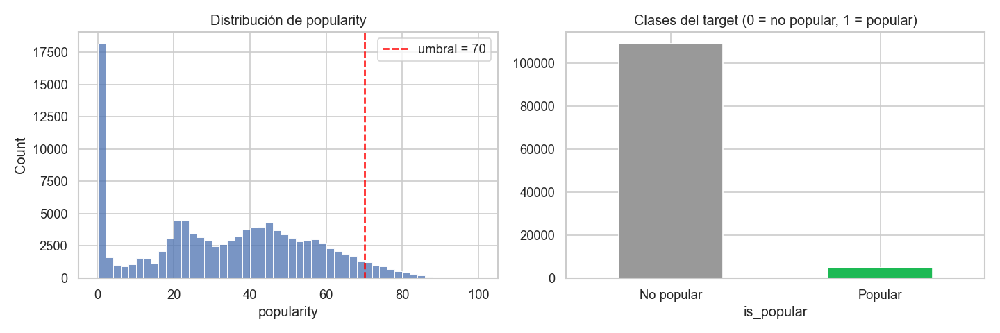

Los ceros de `popularity` se concentran en algunos géneros (jazz 68 %, iranian 66 %, romance 64 %, soul 61 %, latin 59 %, country 59 %). Es poco probable que sean canciones realmente sin oyentes: podrían ser datos sin puntuar. Esto introduce ruido en el target.

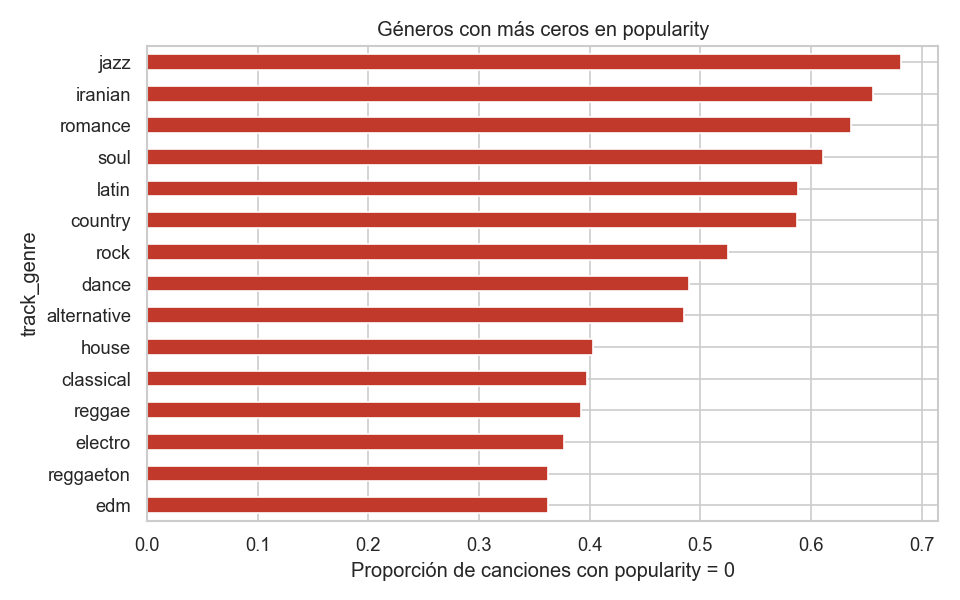

### 6.3 Variables de audio

Las canciones populares tienden a ser más fuertes (`loudness` −6,6 vs −8,3 dB), algo más bailables (0,62 vs 0,56) y menos acústicas (0,22 vs 0,32) e instrumentales (0,04 vs 0,16). Sin embargo, **las diferencias son pequeñas y ninguna correlación de Spearman con `popularity` supera |0,08|**: ninguna variable de audio predice por sí sola.

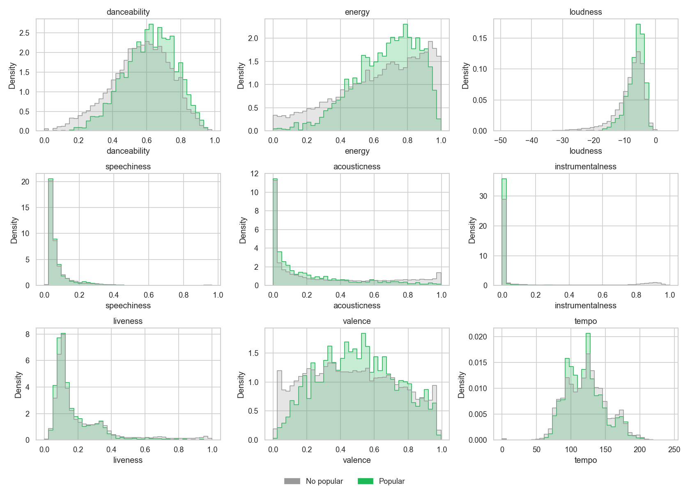 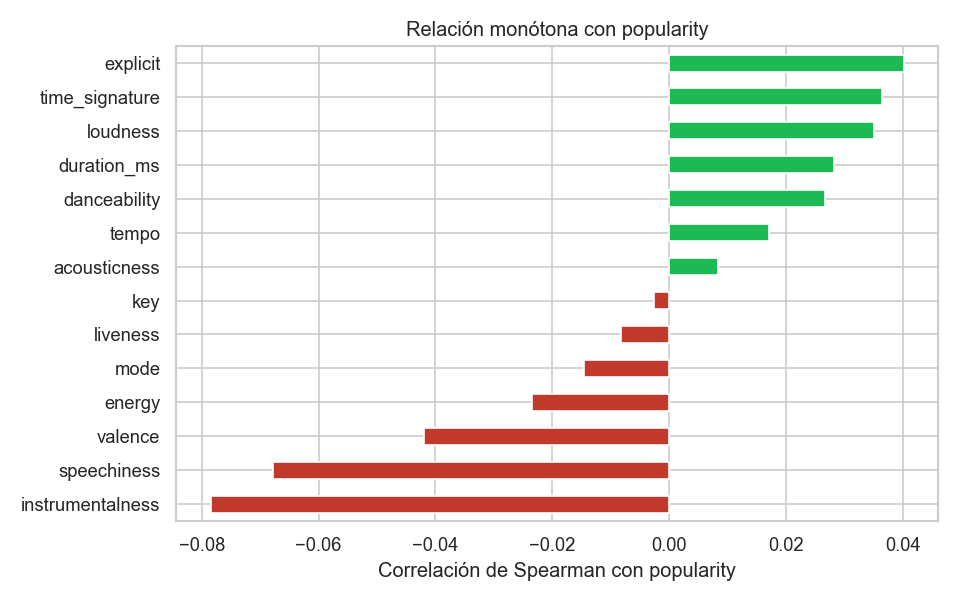

### 6.4 Género y contenido explícito

El género es la variable más informativa: `pop` alcanza 28 % de canciones populares, seguido de `dance` (24 %) y `electro` (22 %), mientras que **26 de los 114 géneros no tienen ninguna canción popular**. Las canciones explícitas son populares más del doble de veces (8,5 % vs 3,9 %).

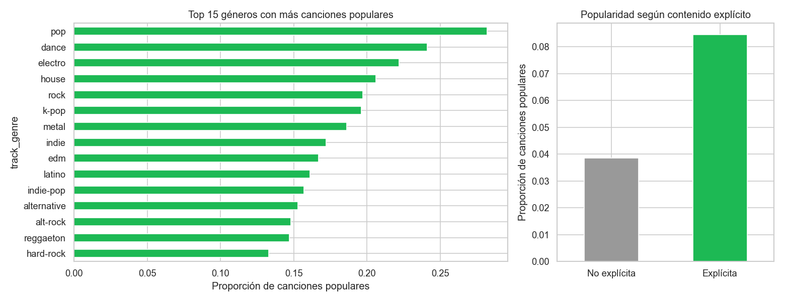

## 7. Preparación de los datos para el modelamiento

- **Variables descartadas:** `Unnamed: 0`, `track_id`, `track_name`, `album_name` y `artists`. Usar `artists` haría que el modelo aprenda *quién* es famoso en lugar de *qué* hace popular a una canción.
- **Variables usadas (supervisados):** 9 de audio, `duration_ms`, `key`, `mode`, `time_signature`, `explicit` y `track_genre`.
- **Transformaciones:** `explicit` pasa a 0/1. En XGBoost, `track_genre` se usa como categórica nativa (sin escalado ni one-hot). En Random Forest se aplica *One-Hot Encoding* (114 columnas), porque scikit-learn no acepta categóricas nativas; el codificador se ajusta solo con train.
- **Partición 60/20/20** (train / validación / test), **agrupada por `track_id` y estratificada por clase**. El notebook verifica que ninguna canción quede en dos conjuntos.
- **Validación** se usa para detener el entrenamiento de XGBoost (*early stopping*) y para elegir el umbral de cada modelo; **test** se usa una sola vez.
- **Para K-Means:** 11 variables numéricas continuas, estandarizadas. Se excluyen el target, los identificadores y las variables categóricas o binarias, porque la distancia euclidiana no es adecuada para ellas.

## 8. Modelado

### 8.1 Supervisado 1: XGBoost (modelo principal)

`XGBClassifier` captura relaciones no lineales entre variables y maneja el género como categórica, algo necesario porque ninguna variable de audio explica sola la popularidad. Funciona por *boosting*: los árboles se entrenan en secuencia y cada uno corrige los errores del anterior.

| Parámetro | Valor | Motivo |
|---|---|---|
| `scale_pos_weight` | negativos / positivos (~22,5) | Compensa el desbalance |
| `eval_metric` | `aucpr` | Adecuada para clases desbalanceadas |
| `early_stopping_rounds` | 50 | Evita sobreajuste |
| `learning_rate`, `max_depth` | 0,05 · 6 | Valores moderados de partida (sin afinar) |
| `subsample`, `colsample_bytree` | 0,8 · 0,8 | Regularización por muestreo |

**Regresión complementaria – `XGBRegressor`.** Misma configuración base, prediciendo `popularity`; reporta el error en puntos.

### 8.2 Supervisado 2: Random Forest (modelo de comparación)

Se eligió porque aprende de forma distinta a XGBoost: entrena muchos árboles **independientes** sobre muestras aleatorias y promedia sus votos (*bagging*). Si ambos algoritmos llegan a conclusiones parecidas, los patrones son más confiables.

| Parámetro | Valor | Motivo |
|---|---|---|
| `n_estimators` | 500 | Cantidad de árboles |
| `max_depth` | sin límite | El sobreajuste se controla con las dos siguientes |
| `min_samples_split`, `min_samples_leaf` | 5 · 2 | Tamaño mínimo para dividir un nodo / dejar una hoja |
| `class_weight` | `balanced` | Compensa el desbalance (~4 % populares) |

**Comparación justa:** mismos conjuntos y mismo tratamiento del desbalance. **Cada modelo usa su propio umbral**, elegido maximizando F1 en validación (el umbral de uno no sirve para el otro, porque sus probabilidades tienen distinta escala). Además se compara el **PR-AUC**, que no depende del umbral.

**Líneas base:** predecir siempre "no popular" (clasificación) y siempre el promedio (regresión).

### 8.3 No supervisado: K-Means

Segmenta las canciones en perfiles musicales usando solo sus variables de audio; **no ve la popularidad**, que se usa después para interpretar los grupos. K se evaluó entre 2 y 10 con el método del codo y la silueta.

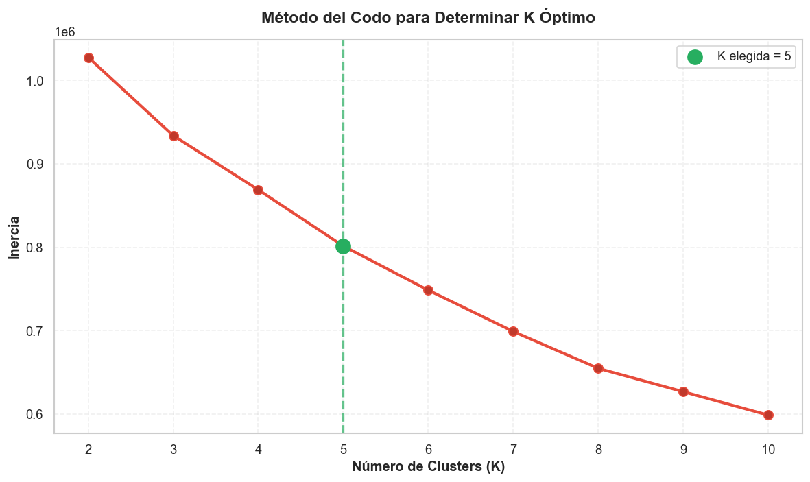

El codo sugiere **K = 5**. La silueta es mayor con K = 2 (≈ 0,25) que con K = 5 (≈ 0,15), pero K = 2 solo separa de forma gruesa las canciones acústicas de las enérgicas; con K = 5 aparecen perfiles distinguibles y útiles. **Se elige K = 5 priorizando la interpretabilidad**, y se declara que una silueta cercana a 0,15 implica grupos que se traslapan.

## 9. Resultados

Todas las métricas son sobre el conjunto de **test**.

### 9.1 Clasificación

| Modelo | Umbral | Precision | Recall | F1 | PR-AUC |
|---|---|---|---|---|---|
| Línea base (siempre "no popular") | – | 0,000 | 0,000 | 0,000 | 0,043 (prevalencia) |
| XGBoost (umbral 0,5) | 0,500 | 0,154 | 0,746 | 0,255 | 0,239 |
| **XGBoost (umbral óptimo)** | 0,727 | 0,230 | 0,463 | **0,307** | **0,239** |
| Random Forest (umbral óptimo propio) | ≈ 0,22 | ≈ 0,21 | ≈ 0,44 | ≈ 0,28 | ≈ 0,185 |

> Los valores de XGBoost provienen de la ejecución del notebook. Los de Random Forest con umbral propio se muestran redondeados (≈) y pueden variar levemente según la versión de scikit-learn; la tabla exacta la imprime la celda de comparación de la sección 6.3 del notebook.

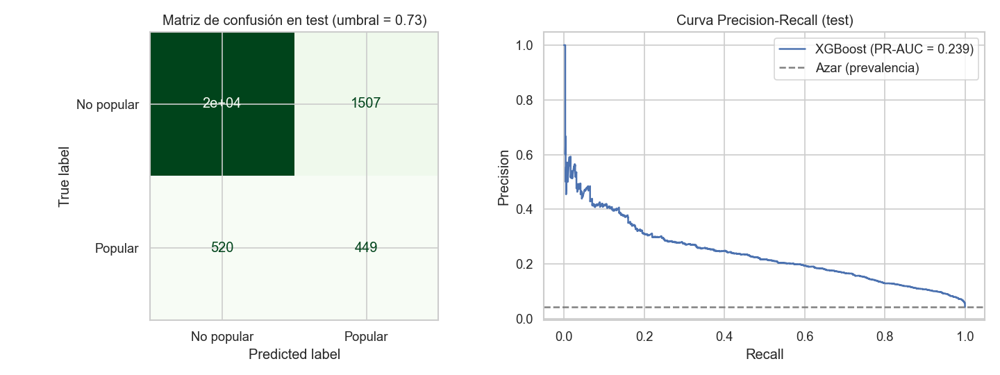
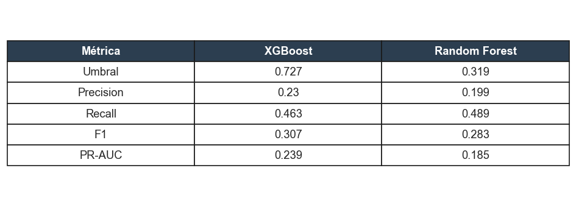

### 9.2 Regresión

| Modelo | MAE | RMSE |
|---|---|---|
| Línea base (promedio) | 18,911 | 22,330 |
| XGBoost | 12,269 | 17,404 |

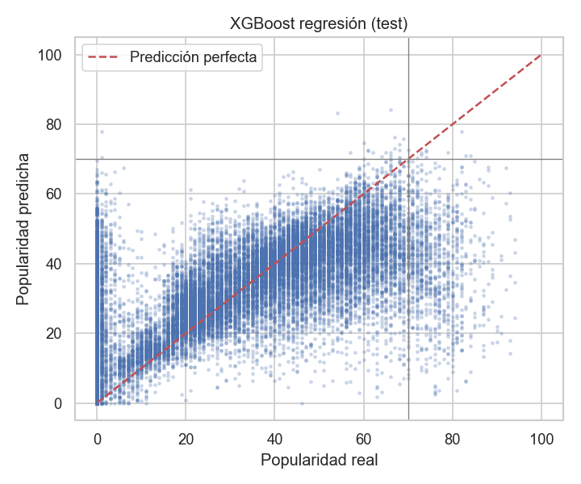

### 9.3 Segmentación (K-Means, K = 5)

| Perfil | % del catálogo | % populares | Veces la prevalencia (4,25 %) |
|---|---|---|---|
| Bailable / Alegre | 37,1 % | 6,3 % | 1,49 |
| Acústico / Íntimo | 21,6 % | 3,7 % | 0,87 |
| Intenso / Oscuro | 26,9 % | 3,6 % | 0,84 |
| En vivo | 7,3 % | 1,5 % | 0,35 |
| Instrumental / Ambiental | 7,1 % | 0,6 % | 0,13 |

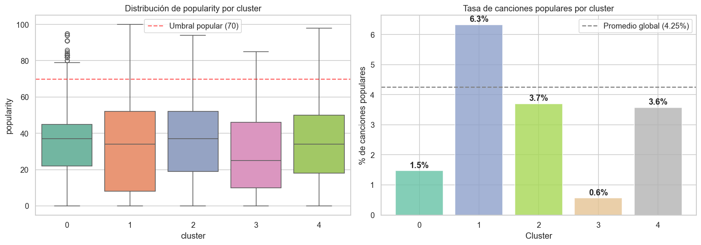

### 9.4 Importancia de variables

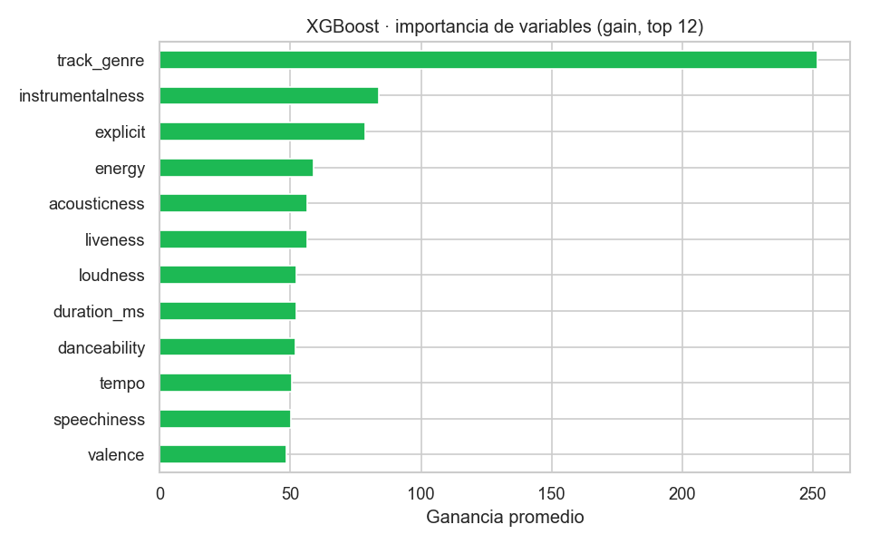 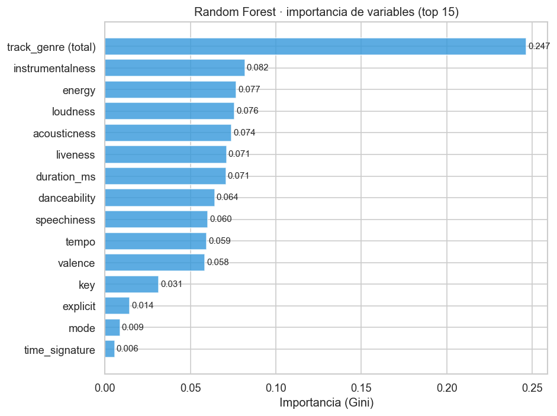

## 10. Interpretación, recomendaciones, ética y limitaciones

### Interpretación de las métricas

- **XGBoost supera con claridad al azar.** Con el umbral óptimo ordena las canciones **unas 5,6 veces mejor que el azar** (PR-AUC 0,239 frente a 0,0425). De cada 100 canciones recomendadas, unas 23 son realmente populares (contra 4 si se eligieran al azar), y el modelo detecta unas 46 de cada 100 canciones populares. Es una mejora real, pero **más de tres de cada cuatro recomendaciones no serán éxitos**: por eso se propone como ranking de apoyo, no como decisor.
- **El umbral es una decisión de negocio.** Con 0,5 el Recall sube a 0,75 pero la Precision baja a 0,15; con 0,727 se equilibran.
- **XGBoost vs Random Forest.** Con su propio umbral, Random Forest queda cerca de XGBoost en F1 pero por debajo en PR-AUC (≈ 0,185 vs 0,239), por lo que XGBoost se mantiene como modelo principal. Que dos algoritmos de naturaleza distinta lleguen a un nivel parecido sugiere que el límite lo pone la información disponible y no el algoritmo.
- **Regresión.** El MAE baja de 18,9 a 12,3 puntos (−35 %) frente a predecir el promedio. Un error típico de ~12 puntos es demasiado grande para decidir si una canción cruza el umbral de 70, pero sirve para ordenarlas por potencial.
- **Variables.** En Random Forest el **género** es la variable más importante (sumando sus 114 columnas aporta ≈ 23 %, casi el triple que cualquier variable de audio individual); las de audio se reparten el resto de forma pareja (≈ 6–8 % cada una). Es coherente con el EDA.
- **Segmentación.** El perfil *Bailable / Alegre* concentra más éxitos (≈ 1,5 veces el promedio) y coincide con el perfil de las canciones populares del EDA; *Instrumental / Ambiental* y *En vivo* casi no tienen éxitos masivos. Como la silueta es baja (≈ 0,15), los perfiles son **tendencias, no reglas**: incluso en el mejor perfil, 94 de cada 100 canciones no son populares.

### Recomendaciones para el negocio

1. **Usar el modelo como ranking de apoyo:** priorizar la revisión de las canciones con mayor probabilidad según XGBoost.
2. **Ajustar el umbral al presupuesto:** alto (≈ 0,73) para campañas costosas; más bajo (0,5) para explorar talento de forma amplia.
3. **Combinar con el perfil musical:** dar prioridad de promoción masiva al perfil *Bailable / Alegre* y tratar *Instrumental / Ambiental* y *En vivo* como nichos con otra estrategia (por ejemplo, playlists temáticas), sin descartarlos.
4. **No usar el modelo para rechazar artistas** (ver ética).
5. **Mejorar el desempeño** incorporando información que hoy falta (artista, fecha de lanzamiento, presencia en playlists, marketing), revisando los ceros de `popularity` y afinando hiperparámetros.

### Ética y sesgos

- Se excluye `artists` para no reproducir el sesgo de "los ya famosos siempre serán populares", que perjudicaría a artistas nuevos.
- La popularidad refleja lo que Spotify ya promociona; el modelo podría reforzar géneros dominantes (pop, dance) en desmedro de otros.
- Usar el modelo como ranking de apoyo, no como decisor automático.

### Limitaciones

- Solo hay atributos de audio: no hay información de artista, marketing, fecha de lanzamiento ni playlists, que explican gran parte de la popularidad.
- Los ceros de `popularity` (14 % de las filas) pueden ser datos sin puntuar y distorsionar el target.
- La muestra por género es artificialmente pareja (1.000 por género).
- Los hiperparámetros de ambos modelos son puntos de partida, sin afinar.
- K-Means usa las 114.000 filas, por lo que las canciones repetidas en varios géneros pesan más de una vez; y la silueta baja indica grupos traslapados.
